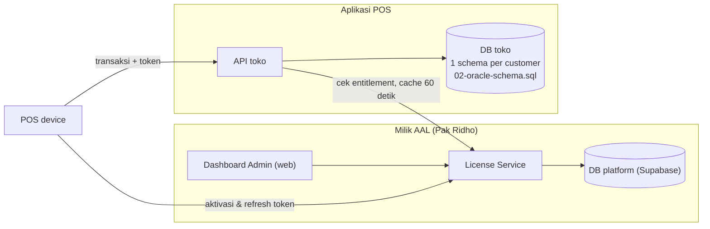
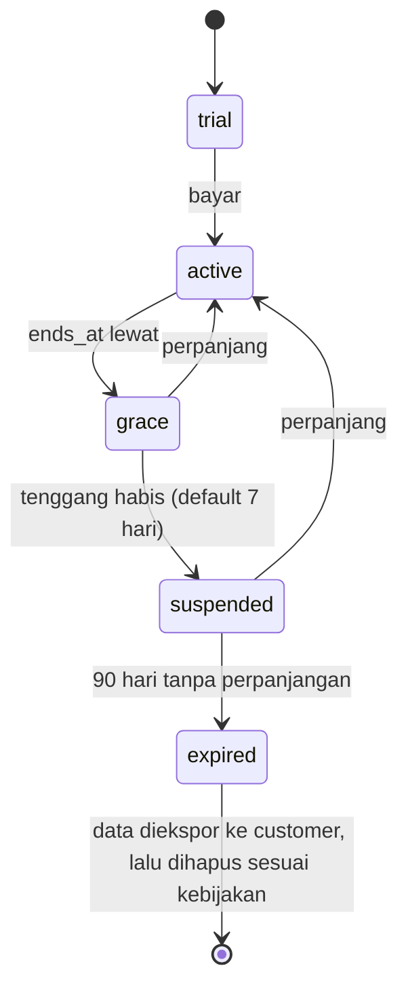

# Lisensi, Langganan & Dashboard Admin (Control Plane)

Status: draf Fase 2, 13/10/2026. Skema: `supabase/migrations/20261013000000_init.sql` (sudah diuji di PostgreSQL 16: device ke-3 pada paket 2 kasir ditolak `DEVICE_QUOTA_EXCEEDED`).

## 1. Celah yang harus disadari dulu

1. **"Berapa orang" harus dihitung per device kasir, bukan per akun.** Kalau dihitung per akun, satu akun bisa dipakai bersama oleh tiga kasir di tiga HP. Aktivasi per device jauh lebih sulit diakali. Akun user tetap dibatasi, tetapi sebagai kuota kedua. [Certain]
2. **Kasir offline tidak bisa dicek seketika.** Kalau lisensi hanya dicek online, customer cukup mematikan internet untuk memakai aplikasi tanpa batas. Solusinya, device memegang token lisensi bertanda tangan yang berlaku maksimal 72 jam dan harus diperbarui online. Konsekuensinya, pencabutan lisensi baru efektif paling lambat 72 jam di device yang offline. [Certain]
3. **Langganan habis tidak boleh menyandera data customer.** Saat suspended, customer tetap bisa login, melihat laporan, dan mengekspor data, tetapi tidak bisa membuat transaksi baru. Memblokir total berisiko sengketa dan bertentangan dengan prinsip UU PDP soal hak akses data. [Likely]
4. **Model ini memperkuat pilihan cloud.** Versi on-prem bisa dibajak (jam sistem dimundurkan, binary di-patch). Kalau ada customer yang memaksa on-prem, lisensinya harus memakai pendekatan lain. [Certain]

## 2. Konsep

| Istilah | Arti |
|---|---|
| **Customer ID** | Kode tenant, mis. `CUST-00001`. Dibuat otomatis saat Pak Ridho mendaftarkan customer. |
| **License key** | `AAL-XXXXX-XXXXX-XXXXX-XXXXX`, 100 bit acak. Ditampilkan **sekali** saat dibuat. Server hanya menyimpan hash. Satu key aktif per customer; bisa di-reset. |
| **Paket (plan)** | Kuota: outlet, device kasir, akun user, fitur. Contoh di bawah. |
| **Langganan** | Periode aktif `starts_at` sampai `ends_at` + masa tenggang. Perpanjangan dicatat sebagai baris baru (riwayat utuh). Kuota bisa di-override per customer. |
| **Aktivasi device** | Setiap HP/tablet/PC kasir harus diaktifkan dan memakan 1 kuota. Device lama bisa dinonaktifkan untuk membebaskan kuota. |

Contoh paket ([Guessing], harga diputuskan Pak Ridho):

| Paket | Outlet | Device kasir | Akun user | Fitur tambahan |
|---|---|---|---|---|
| STARTER | 1 | 2 | 5 | — |
| PRO | 1 | 5 | 15 | promo, member |
| MULTI | 5 | 15 | 50 | multi-outlet, transfer stok, QRIS dinamis |

## 3. Arsitektur

Data operasional toko dan data lisensi dipisah di dua database. Dengan begitu bug atau kebocoran di sisi toko tidak bisa mengubah kuota atau masa aktif.

## 4. Alur

### 4.1 Onboarding customer baru (oleh Pak Ridho)
1. Dashboard admin → Tambah customer → isi data usaha → pilih paket, tanggal mulai/berakhir, harga.
2. Sistem membuat Customer ID, schema database toko, akun owner awal, dan license key.
3. License key ditampilkan sekali; kirim ke owner lewat kanal aman.

### 4.2 Setup di toko
1. Owner login di web back-office pertama kali → masukkan Customer ID + license key → terhubung.
2. Pasang aplikasi kasir di device → owner/manager login di device → **Aktivasi device** → server cek kuota.
3. Bila kuota penuh: pesan "Kuota kasir penuh (2 dari 2). Nonaktifkan device lain atau hubungi penyedia untuk upgrade."

### 4.3 Token lisensi offline
- Setelah aktivasi/refresh, server menerbitkan token yang ditandatangani (Ed25519) berisi: customer ID, device ID, paket, fitur, `valid_until = min(akhir langganan + tenggang, sekarang + 72 jam)`.
- POS memverifikasi tanda tangan & masa berlaku secara lokal di setiap pembukaan shift dan setiap 1 jam.
- POS mencoba refresh tiap 1 jam saat online. Jam device yang mundur jauh dari waktu server terakhir dianggap mencurigakan → wajib online.

### 4.4 Siklus status langganan

| Status | Kasir | Back-office | Banner |
|---|---|---|---|
| trial / active | Normal | Normal | H-14, H-7, H-1 sebelum habis |
| grace | Normal | Normal | Merah: "Langganan habis, X hari tersisa" |
| suspended | **Tidak bisa transaksi** | Hanya lihat laporan & ekspor | Hubungi penyedia |
| expired | Tidak bisa login | Hanya unduh ekspor data | — |

### 4.5 Penegakan kuota ("kalau lebih, tidak bisa akses")
| Kuota | Dicek saat | Lapisan |
|---|---|---|
| Device kasir | Aktivasi device | API + trigger DB (`enforce_device_quota`, aman dari race condition) |
| Akun user aktif | Membuat/mengaktifkan user | API toko memanggil License Service |
| Outlet | Membuat outlet | API toko |
| Fitur | Setiap endpoint fitur berbayar | Middleware membaca `features` dari entitlement |
| Status langganan | Setiap request API + token di POS | Middleware (cache 60 detik) + token |

Downgrade paket tidak memutus device yang sudah aktif secara otomatis; owner diminta memilih device mana yang dinonaktifkan sebelum downgrade berlaku.

## 5. Dashboard Admin (milik Pak Ridho)

**Halaman ringkasan**
- Total customer aktif / grace / suspended, MRR (pendapatan bulanan berulang).
- Daftar yang akan habis dalam 30 hari.
- Customer tidak aktif (tidak ada transaksi 14 hari, risiko berhenti).

**Daftar customer** (dari `v_admin_tenant_overview`): Customer ID, nama toko, owner, paket, status, mulai, berakhir, sisa hari, device terpakai/kuota, user terpakai/kuota, terakhir online, transaksi 30 hari.

**Detail customer**
- Riwayat langganan & invoice.
- Daftar device: nama, versi aplikasi, terakhir online, IP → tombol **Nonaktifkan**.
- Aksi: Perpanjang, Ganti paket, Override kuota, Suspend manual, Reset license key, Tandai invoice lunas.
- Log validasi lisensi (deteksi percobaan device ke-n yang ditolak, key salah berulang).

**Keamanan dashboard:** login admin wajib 2FA (TOTP), role admin (superadmin, sales, support, viewer), semua aksi tercatat di `platform_audit_logs` yang tidak bisa dihapus.

## 6. Endpoint License Service

| Endpoint | Dipanggil oleh |
|---|---|
| `POST /license/v1/bind` (Customer ID + key) | Back-office, sekali saat setup |
| `POST /license/v1/devices/activate` | POS |
| `POST /license/v1/devices/refresh` → token baru | POS, tiap 1 jam |
| `POST /license/v1/devices/{id}/deactivate` | Owner (back-office) / admin |
| `GET /license/v1/entitlements` | API toko (cache 60 detik) |
| `GET/POST /admin/v1/tenants`, `/subscriptions`, `/plans`, `/invoices`, `/devices` | Dashboard admin |
| `POST /admin/v1/tenants/{id}/license-keys:reset` | Dashboard admin |

Rate limit ketat pada `bind` dan `activate` (mis. 10 percobaan / 15 menit per IP) untuk mencegah tebak key.

## 7. Masuk fase mana

Lisensi & kuota masuk **MVP**. Kalau ditunda, customer pertama terlanjur memakai tanpa batas dan sulit dibatasi belakangan. Pembayaran otomatis (payment gateway untuk invoice langganan) masuk Fase 2; di MVP, invoice ditandai lunas manual oleh admin.
